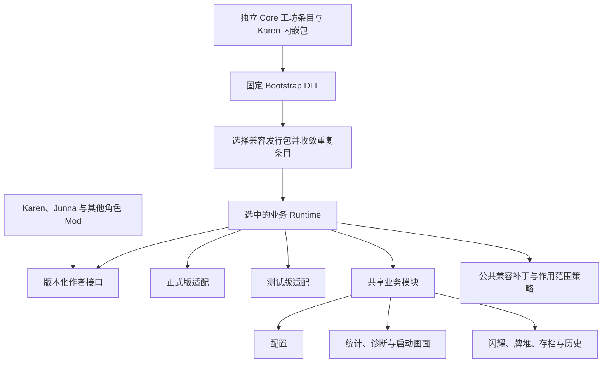

# ShoujoKagekiAijoCore 实现文档

本文面向 Core 开发、部署和维护者，记录 Core 1.2.0 的实现约定，整理日期为 2026-11-08。使用方式与作者接入示例见 [Core 使用说明](../README.md)。

源码与文档位于 Core 的 GitHub 仓库，SDK 随正式发行提供。工程示例采用相对路径。[GitHub 仓库](https://github.com/backinfile/STS2_ShoujoKagekiAijoCore)

## 1. 项目定位与发布决策

Core 作为独立游戏 Mod 维护并发布到创意工坊。仅 Karen 的角色工坊包内嵌完整 Core；Junna 及其他 Mod 声明独立 Core 条目的工坊依赖，玩家订阅对应必需物品。

共同约定如下。

- 逻辑 Mod ID 固定为 `ShoujoKagekiAijoCore`。
- 角色使用官方 Core SDK，构建时记录所采用的发行版本与文件摘要；仅 Karen 随包携带完整 Core。
- 一个游戏进程使用一份已选定的 Core 业务实现、一份公共配置和一组共享机制状态。
- 引导 DLL 维持固定加载协议，业务代码、配置界面、资源和游戏版本适配在外置业务包中更新。
- 角色作者通过版本化公开接口接入。Core 发布以旧角色 DLL 的二进制兼容和旧存档兼容为验收条件。
- 正式版、测试版作为两个独立适配目标，随同一个 Core 发行包交付。

独立 Core 条目只包含 Core Mod。Karen 条目将角色目录和 Core 目录并列放在上传内容目录中，游戏递归读取清单并记录对应工坊来源。

| 发布方式 | 更新来源 | 适用对象 |
| --- | --- | --- |
| 独立 Core 工坊条目 | Core 自身订阅 | Junna 及其他依赖 Core 的 Mod |
| Karen 内嵌完整 Core | Karen 订阅 | Karen 玩家 |

角色游戏清单用 Mod ID 声明加载依赖；工坊配置用条目数字 ID 声明必需物品。Core 的工坊配置依赖 BaseLib，其他角色的工坊配置同时依赖 BaseLib 与独立 Core 条目。官方 ModUploader 读取 `workshop.json` 并同步条目依赖。[ModUploader 文档](https://github.com/megacrit/sts2-mod-uploader/tree/main/template)

## 2. 本体行为与 Core 需要补充的能力

以下行为依据本机游戏 `sts2.dll` 中的 `ModManager`、`ModManifest`、`ModDependency` 和 `AssemblyInfo` 检查结果整理。后续游戏更新时由适配矩阵复核。

| 场景 | 本体处理 |
| --- | --- |
| 本地与工坊存在相同 ID | 比较有效的清单版本，采用较高版本 |
| 上述两份版本相同，或版本信息缺失、解析失败 | 优先本地版本 |
| 两个工坊条目存在相同 ID | 第一份成功加载后，后续同 ID 条目进入重复 ID 错误分支 |
| 一个工坊包内存在多个同 ID 清单 | 适用相同的重复 ID 检查 |
| 两个本地目录存在相同 ID | 适用相同的重复 ID 检查 |
| 依赖声明带有 `min_version` | 对已经加载的依赖进行最低版本检查 |

关键调用顺序为发现清单、处理禁用及本地与工坊重复项、依赖排序、逐项 `TryLoadMod()`、后续模型与本地化初始化。

`TryLoadMod()` 会直接跳过状态已经变化的条目。引导器利用这一启动时机，将多份 Core 收敛为一个逻辑加载条目。具体游戏内部字段的访问集中在适配代码中，并列为发布前必须实测的部分。

同一个 `AssemblyLoadContext` 对每个程序集简单名称容纳一个已加载版本。候选版本比较发生在业务程序集首次加载之前，随后复用该程序集实例。[微软文档](https://learn.microsoft.com/en-us/dotnet/core/dependency-loading/understanding-assemblyloadcontext)

## 3. 工程与发行目录

### 3.1 Core 仓库

```text
STS2_ShoujoKagekiAijoCore/
  ShoujoKagekiAijoCore.json  正式 Mod 清单
  workshop.json            独立 Core 工坊配置
  build.ps1                双版本构建与完整 Mod 目录
  prepare-release.ps1      ZIP、哈希与工坊工作区
  publish-workshop.ps1     官方 ModUploader 上传入口
  src/
    Bootstrap/             固定入口、候选发现、版本选择、启动诊断
    Api.V1/                面向角色作者的第一版公开接口
    Runtime/               公共业务、状态与模块调度
    Compatibility/Stable/  正式版适配
    Compatibility/Beta/    测试版适配
    Modules/               配置、诊断、统计、启动画面、闪耀等
    Patches/               公共兼容补丁、作用范围策略与统一注册
  resources/               Core 公共图像、音频、本地化和场景
  services/telemetry/       对局与报错服务、SQLite 持久化
  web/telemetry/            对局、统计、报错查询页面
  deploy/telemetry/         服务安装、反向代理、备份和发布脚本
  sdk/                     引用程序集、打包工具与作者示例
  docs/                    架构、接口、迁移与发行说明
  tests/                   引导、二进制兼容、存档与游戏内验收
```

工程目录按以上模块职责组织。各角色仓库通过固定发行版本或仓库引用取得 SDK。独立 Core 条目和 Karen 内嵌包使用同一官方构建产物。Core 仓库同时维护游戏客户端、独立服务端和 Web 页，服务端与 Web 页通过独立部署产物发布。

### 3.2 独立 Core 工坊工作区

```text
workshop/
  workshop.json
  image.png
  mod_id.txt                 首次成功上传后生成，更新时沿用
  content/
    ShoujoKagekiAijoCore/
      ShoujoKagekiAijoCore.json
      ShoujoKagekiAijoCore.dll
      core.bundle
      lib/1.2.0/
        api/ShoujoKagekiAijoCore.Api.V1.dll
        stable/ShoujoKagekiAijoCore.Runtime.Stable.dll
        beta/ShoujoKagekiAijoCore.Runtime.Beta.dll
      resources/1.2.0/Core.Resources.pck
      sdk/...
```

目录中的 `1.2.0` 为格式示例。Core 清单与引导 DLL 放在同一目录，业务文件按发行版本分组。`build.ps1` 生成完整 Core Mod，`prepare-release.ps1` 生成以上工作区、ZIP 和哈希，上传使用 `publish-workshop.ps1`。命令与首次发布、更新步骤见 [发布说明](RELEASING.md)。

### 3.3 角色工坊上传内容

```text
KarenWorkshop/content/
  ShoujoKagekiAijoKaren/
    ShoujoKagekiAijoKaren.json
    ShoujoKagekiAijoKaren.dll
    ShoujoKagekiAijoKaren.pck
    core.requirements
    core.package.lock
  ShoujoKagekiAijoCore/        与独立条目相同的完整官方发行包

OtherRoleWorkshop/content/
  ShoujoKagekiJunna/
    ShoujoKagekiJunna.json
    ShoujoKagekiJunna.dll
    ShoujoKagekiJunna.pck
    core.requirements
    core.package.lock
    lib/...
```

`sdk/pack-character.ps1` 仅在 Mod ID 为 `ShoujoKagekiAijoKaren` 时复制 Core。其他 Mod 的工坊配置声明独立 Core 条目依赖。`core.package.lock` 记录构建输入，运行时依照清单与能力要求选择兼容 Core。

`core.bundle` 与 `core.requirements` 使用 JSON 内容和上述固定扩展名。游戏递归扫描 `.json` 作为潜在 Mod 清单，这两类元数据使用专用扩展名以表达各自用途。

Core 的游戏清单声明 `has_dll`，公共资源包由选中版本的引导流程挂载。资源包与业务程序集作为同一个发行单元校验、选择和加载。角色资源使用各自的资源根目录，Core 资源统一位于 `res://ShoujoKagekiAijoCore/`。

## 4. 分层架构



| 层次 | 责任 | 更新约定 |
| --- | --- | --- |
| Bootstrap | 发现候选、读取元数据、选择发行包、去重、加载、早期失败报告 | 加载协议长期固定 |
| Api.V1 | 作者可使用的公开类型、方法、事件和数据传输类型 | 同一接口主版本保持二进制兼容 |
| Runtime | 模块生命周期、共享状态、规则调度、业务实现 | 通过独立 Core 订阅或 Karen 内嵌发行包更新 |
| GameAdapter | 游戏与 BaseLib 的版本差异、反射扫描、序列化和原生钩子接入 | 正式版与测试版分别验证 |
| Patches | 公共兼容补丁、玩法约束、适用范围及旧补丁交接 | 通过 GameAdapter 获取对应版本目标，集中注册与撤销 |
| Modules | 配置、统计、诊断、启动画面、共享机制与工具 | 各自声明功能版本与存档格式 |
| 角色 Mod | 角色牌池、具体牌效、知识关系、角色素材和奖励内容 | 声明依赖与牌上的闪耀次数，按需使用特殊牌效接口 |

BaseLib 提供现有的配置、枚举、牌堆、存档与钩子基础。Core 在这些能力上实现少女歌剧 Mod 之间的共同约定，适配代码优先调用 BaseLib 已有接口。

## 5. 固定引导 DLL

### 5.1 引导协议

固定入口文件名为 `ShoujoKagekiAijoCore.dll`。第一版引导协议使用 `BootstrapProtocol = 1`，包含以下稳定约定。

- 入口类型、初始化方法和反射调用签名。
- `core.bundle`、`core.requirements` 的查找位置和必需字段。
- 候选读取、版本排序、文件校验和错误报告方式。
- 选中业务程序集的入口类型与参数传递格式。
- 进程内单次选择、单次初始化的协调标识。

引导程序集保持稳定程序集标识。业务接口以自己的程序集与版本治理，角色作者引用公开接口程序集。

引导协议增加字段时，旧引导器按既有字段读取，新字段具有向后兼容的默认语义。第一版协议有效期间，每个发行包继续携带能够读取该协议的引导器。需要新增复杂发现策略时，采用固定入口加载的业务侧选择模块，并保持最早入口能够找到和调用它。

### 5.2 启动步骤

1. 本体完成发现和依赖排序，开始加载第一份可用 Core 清单。
2. 固定入口建立进程协调状态，并定位当前正在初始化的逻辑 Core 条目。
3. 枚举本体已发现的 Core 条目和角色需求。用户禁用、已失败或游戏目标不匹配的条目按状态排除。本体因重复来源而抑制的条目保留明确的来源分类，候选资格由适配器判定。
4. 读取候选元数据、角色所需接口与功能、游戏目标和 BaseLib 要求，得到共同满足的发行包集合。
5. 按语义化版本选择最高兼容发行包。同版本文件摘要一致时，按稳定来源标识选取文件路径。同版本摘要存在分歧时报告发行冲突，停止使用分歧产物。
6. 先校验选中发行包的全部必需文件，再加载公开接口、当前游戏目标的业务程序集和公共资源。
7. 在内存中将当前 Core 条目的有效版本同步为选中版本，同时维护本体读取的清单版本与已解析版本字段。
8. 将其余符合重复定义的 Core 条目标为重复禁用，并保证依赖查找首先命中当前逻辑条目。
9. 将选中的业务程序集归属关联到 `ShoujoKagekiAijoCore`。在模型、枚举、本地化与联机类型缓存建立前完成反射发现接入。
10. 初始化核心状态和公共默认模块，建立唯一配置入口。角色按本体流程初始化模型，Core 在模型发现阶段自动识别角色、牌池、资料与闪耀声明。

业务初始化结果在进程内固定。进程重启时重新执行候选选择。工坊在磁盘上的后续更新供下次启动使用。

步骤 7～9 涉及本体内部状态，是该方案的重点验证对象。正式版适配需处理早期版本缺少程序集关联接口的情况，测试版适配需处理其多程序集归属与缓存初始化顺序。

### 5.3 角色需求与候选元数据

角色清单声明 Core 的最低发行版本，供本体排列加载顺序和执行基础依赖检查。

```json
{
  "id": "ExampleCharacterMod",
  "version": "1.0.0",
  "has_dll": true,
  "has_pck": true,
  "affects_gameplay": true,
  "dependencies": [
    { "id": "BaseLib", "min_version": "3.4.7" },
    { "id": "ShoujoKagekiAijoCore", "min_version": "1.0.0" }
  ]
}
```

角色目录中的 `core.requirements` 由 SDK 打包工具生成，记录公开接口和功能要求。Core 从本体清单读取角色身份，从生成元数据读取兼容要求。普通接入通过清单依赖和接口引用完成。

```json
{
  "format": 1,
  "modId": "ExampleCharacterMod",
  "apiMajor": 1,
  "minimumApiVersion": "1.0.0",
  "requiredFeatures": ["shine@1"],
  "optionalFeatures": ["diagnostics@1", "card-export@1"]
}
```

Core 发行包中的 `core.bundle` 至少包含引导协议、发行版本、公开接口版本、功能版本、正式版与测试版文件路径、支持的游戏范围、BaseLib 要求、资源版本、文件摘要及存档与网络协议版本。

候选检查读取元数据和程序集文件头，业务加载发生在选定之后。候选路径均相对于所属发行目录解析，并核对完整路径与清单摘要。

### 5.4 版本例子

| 安装情况 | 选择结果 |
| --- | --- |
| 只装附带 Core 1.0 的 Karen | 采用 1.0 |
| 仅安装独立 Core 1.2 与依赖它的 Junna | 采用 1.2 |
| Karen 附带 1.0，独立 Core 为 1.2，两个角色都使用接口 V1 | 采用共同兼容的 1.2 |
| Karen 内嵌与独立条目均为内容一致的 1.2 | 一份逻辑 Core 使用该发行包 |
| 较新包缺少当前正式版适配，旧包包含正式版适配 | 在覆盖当前目标的兼容候选中选择，并显示实际版本 |
| 新角色需要新增功能，所有候选均缺少该功能 | 在角色进入模型初始化前报告所缺功能和要求版本 |

Karen 发行包携带满足自身需求的完整 Core。其他角色通过独立 Core 工坊依赖取得兼容版本。角色作者更新自己的包时同步最低版本与能力要求，旧角色继续通过已发布接口使用被选中的兼容实现。

### 5.5 加载顺序与初始化前检查

依赖顺序固定为 BaseLib → ShoujoKagekiAijoCore → 角色 Mod。Core 清单声明 BaseLib 依赖，角色清单声明 Core 及其余实际依赖，加载器按依赖关系处理顺序。

在引导流程中核对 BaseLib 和选中 Core 的有效版本、角色最低要求、依赖环、已发现依赖的状态及反射缓存初始化阶段。单个清单中依赖项的书写顺序只描述关系，实际加载顺序取决于完整依赖图。

提示包含具体依赖名、要求版本、当前版本和处理动作。向玩家显示的基本提示采用以下内容。

| 情况 | 提示文本 |
| --- | --- |
| BaseLib 缺失 | 缺少 BaseLib，请安装 3.4.7 或更新的兼容版本。 |
| Core 版本不足 | Core 版本过低，该角色要求 1.2.0，当前为 1.0.0。 |
| 手动顺序错误 | 加载顺序需要调整，请按 BaseLib → Core → 角色 Mod 排列。 |
| 依赖环 | 检测到循环依赖，后接涉及的 Mod ID 与依赖链。 |

Core 初始化之前的缺失依赖由本体依据清单报告，Core 可运行后的补充检查由引导流程报告。对不满足必需依赖的接入路径，在模型初始化前结束并保留具体诊断。

首次发布在正式版与测试版分别验证依赖排序、手动排序、缺失、版本不足和循环依赖提示。

## 6. 正式版与测试版支持

正式版和测试版均为一级支持目标。初始参考基线取自现有 Junna 工程，分别为正式版 0.107.1、测试版 0.111.0，BaseLib 3.4.7。每次发行以该次验证过的完整版本范围为准。

| 项目 | 约定 |
| --- | --- |
| 引导入口 | 一个固定入口，读取本体发行信息选择目标 |
| 作者接口 | 同一接口主版本对两个目标提供相同公开契约 |
| 业务实现 | 正式版与测试版分别构建，并随包交付 |
| 原生差异 | 集中处理结果牌区、伤害调用、复制、钩子、存档和反射扫描差异 |
| 目标识别 | 按发行信息与显式支持矩阵识别，列出目标范围与对应产物 |
| 游戏更新 | 新目标先通过适配和定向验收，再更新支持矩阵 |
| 联机 | 对局参与者使用一致的游戏目标和 Core 网络指纹 |

公开接口优先使用两版共同的模型类型和 Core 自有数据类型。某个游戏版本独有的方法签名由 GameAdapter 转换为公共接口。

发行说明分别列出两版结果，包括具体游戏版本、BaseLib 版本、验证过的角色版本和已知适配限制。某一版的成功构建与另一版的实机结果分别记录。

## 7. 外部接口稳定与更新策略

### 7.1 发布约束

Core 发布时优先保持外部接口稳定。以下内容属于公开契约。

- 公开程序集名称、命名空间、类型名称和类型归属。
- 方法、构造函数、属性、事件及委托的签名和可见性。
- 关键字 ID、功能 ID、规则集 ID、注册键与本地化键。
- 存档键、字段含义、实例身份和历史记录语义。
- 回调顺序、触发范围、默认行为、错误结果及重试约定。
- 正式版与测试版下共同可依赖的行为。

同一接口主版本采用增量扩展。现有成员继续提供，新能力使用新增方法、重载或独立功能接口。旧成员的兼容实现保留，弃用信息面向作者展示并附迁移路径。

修改可选参数默认值、改变重载选择、移动公开类型到其他程序集、给第三方实现的接口增加必需成员，以及改变回调时机，都纳入兼容审查。源码重新编译通过和已发布 DLL 直接运行分别验证。

### 7.2 三类版本

| 版本 | 用途 |
| --- | --- |
| Core 发行版本 | 标识打包的业务代码、资源和适配集合 |
| 公开接口版本 | 标识作者能够调用的二进制契约 |
| 规则、存档、网络协议版本 | 标识对局行为和持久化格式 |

Core 1.2 可以继续提供接口 V1。未来提供 V2 时，发行包同时保留仍受支持的 V1 接入层，由兼容层连接同一个业务内核。一个关键字的状态写入和结算仍有唯一负责模块。

面向作者的程序集名称拟为 `ShoujoKagekiAijoCore.Api.V1.dll`，命名空间拟为 `ShoujoKageki.Core.V1`。同一接口主版本内保持稳定的 `AssemblyVersion`，发行细节记录在信息版本和发行清单中。

### 7.3 保护现有玩法

共享规则在新局建立时写入对局存档。读档时读取该局规则标识，运行时提供其兼容实现。业务更新中的新默认规则作用于采用该规则的新局。

符合原规则的实现修复按补丁版本发布，并列出影响范围。改变闪耀计次、耗尽时机或奖励语义的调整作为规则变更发布，提供原规则兼容与迁移说明。

旧版角色通过原接口运行。尚未接入 Core 的旧角色按自身实现处理其卡牌，共享闪耀以自动发现的次数声明、动态共享状态和已验证迁移适配为接入依据。

Core 对普通玩家的更新流程为更新独立 Core 订阅或 Karen 包、重启游戏、由引导器选择兼容版本。业务代码在本次进程中保持固定。

## 8. Core 内容清单

### 8.1 首批业务模块

| 模块 | Core 提供的内容 | 角色提供的内容 |
| --- | --- | --- |
| 配置 | 唯一配置页、Core 自身格式升级、重置与变更通知 | 角色特有选项 |
| 信息收集 | 自动识别角色与 Mod 来源，处理版本、对局摘要、共享机制统计和发送队列 | 原生模型与对局记录 |
| 报错收集 | 日志摘要、异常、版本上下文、去重、诊断导出与默认开启的上传 | 明确捕获的业务错误和额外结构化上下文 |
| 长颈鹿启动画面 | 默认播放一次、公共素材、跳过、取消与音频释放 | 可选公共素材扩展 |
| 闪耀 | 识别、次数、重放、耗尽、升级恢复与回调 | 上限、具体牌效、耗尽奖励或变形 |
| 闪耀公共特效 | 常驻微光、临界预警、耗尽、飞入牌堆、到达反馈和牌堆装饰 | 闪耀次数声明，特殊牌区由表现适配提供目标 |
| 闪耀牌堆 | 每玩家耗尽档案、计数、查看入口和复原所需快照 | 哪个效果可以读取或重新获得档案中的牌 |
| 空壳 | 共用 Token 模型、显示资源、耗尽牌复制与转交替代、旧 ID 兼容 | 复制、转交与明确重新获得的操作目的 |
| 存档与联机 | 共享状态、协议、迁移、规则快照、会话检查 | 角色永久成长和自身牌效扩展字段 |
| 历史记录 | 耗尽卡牌区段、共享统计与可读快照 | 角色特有展示数据 |
| 数据服务与 Web | 对局接收、报错接收、查询、统计、备份及页面，自动生成模型资料 | 原生角色、牌池、卡牌与遗物模型 |
| 关键字显示 | 统一 ID、次数展示、提示去重、本地化和预览 | 牌面正文及角色提示 |
| 衍生牌标记 | 来源识别、标签、本地化、即时配置与卡面生命周期 | 原生卡牌生成与复制流程 |
| 音乐播放器 | 播放器、内置曲库、本地目录、快捷键、音量与音乐仲裁 | 角色专属演出及替换曲目的请求 |
| patches | 公共兼容补丁及作用范围策略，包含五轮书、招财异鱼补丁 | 原生模型信息与角色归属 |

### 8.2 Karen 通用能力审查与抽取顺序

本轮以 Karen 现用工程的实际调用点为依据。衍生牌标记与音乐播放器已确认纳入首批迁移，其实现要求见 8.5、8.6。以下工具按共享机制的实际依赖分批抽取。

| 模块与优先级 | Karen 源码依据 | Core 的抽取边界 |
| --- | --- | --- |
| 卡牌来源、复制与转移，随闪耀迁移 | Patches/NCardDerivedLabelPatch、Models/Cards/CardModelEx | 区分战斗生成、临时复制、新永久牌、实际牌转移和档案重获，保留成长、附魔、升级及闪耀状态 |
| 下一次重放，随闪耀迁移 | ExtraReplaySystem | 一次性预算在实际执行时消费，预览读取快照，并与闪耀及延迟效果对齐 |
| 音频与资源生命周期，随公共表现迁移 | Audio/KarenAudioManager、CombatBgmReplacementManager、Utils/KarenResourceLoader | 音频加载、播放句柄、淡出、取消、场景退出与有效背景音乐恢复 |
| 公共绘制与预热，随闪耀特效迁移 | Vfx/KarenVfxCanvasBatch、KarenLightRibbon、KarenPowerVfxAnchor、KarenVfxWarmup | 共用轮廓、锚点、缓存、资源清单和绘制准备，内部统一预算与释放 |
| 触摸输入与牌堆界面，工具阶段 | Utils/KarenPileInput、KarenTapGesture、CombatPileCountCmd 及牌堆按钮 | 共用点击、长按、拖动取消、触摸模拟鼠标去重、焦点与退出清理 |
| 选牌与选项，工具阶段 | Commands/CardSelectCmdEx、CardPileCmdEx、NChooseACardSelectionScreenPatch | 复用原生选择上下文，封装标题、取消、清理和结果回调，保留联机同步 |
| 奖励调度与分组，工具阶段 | Commands/ExtraRewardCmd、Rewards/KarenShineCardReward、KarenShineCardRewardChoice | 战后预约、已生成奖励分组、领取、跳过、存档和去重，候选由具体效果提供 |
| 移牌通知，工具阶段 | GlobalMoveSystem | 提供实际移牌通知与可选的整次出牌汇总，保留原生各阶段顺序 |
| 卡牌导出与 Web 资料，随数据服务迁移 | Utils/CardPngExportUtil、tools/telemetry-server/build_native_assets.py | 自动发现模型，生成 JSON、卡面、关联牌和页面资料，使用完整模型 ID 与所属 Mod |

表中客户端路径相对于 Karen 的 src/Core。Core 对外提供有实际调用需求的稳定命令、只读状态和播放句柄，绘制细节及版本补丁集中在内部实现。

#### 抽取时需要拆开的既有耦合

- CardModelEx 的 CreateTransferCopy 和 ShinePatch.MutableClone_Patch 当前分别处理耗尽后替换 KarenEmptyShell。空壳及这两条替代路径随闪耀迁入 Core，按操作用途统一处理。复制工具使用原生与 BaseLib 保存字段恢复完整状态，角色牌面另有指定变化时由对应回调提供结果。
- GlobalMoveSystem 当前回调依赖 KarenBaseCardModel，并合并 Hand → Play → Discard。Core 保留原生逐次移牌事件，另行提供需要这种合并语义的调用入口。
- CardPileCmdEx 的选项执行依赖 KarenBaseCardModel.DoOption。共享选择返回结果，由具体牌效执行行为。选择标题与清理状态绑定单次请求，处理嵌套、取消、异常和远端选择。
- 奖励分组沿用原始奖励的序列化和同步身份。Core 持有预约与领取回执，牌效提供玩家、候选与随机数来源，按原奖励类型维护获得和跳过记录。
- 卡面 PNG 渲染放在作者导出或发行资料构建阶段。玩家启动阶段完成模型发现和轻量资料读取，Web 使用已生成的资源索引。

### 8.3 优先复用本体与 BaseLib 的能力

以下接口已经核对本体或 BaseLib 3.4.7 实现，抽取时优先沿用。

| 需求 | 已有能力 | Core 补充范围 |
| --- | --- | --- |
| 常规选牌 | BaseLib.Utils.CommonActions.SelectCards | 特殊选项标题、生命周期及实际缺失的同步适配 |
| 计数型能力的显示值 | PowerModel.DisplayAmount 及变更通知 | 将机制状态映射到原生刷新流程 |
| 能力第二数值 | BaseLib.Abstracts.IHasSecondAmount | 公共机制实际需要的第二数值实现 |
| 牌堆、保存与模型发现 | BaseLib 牌堆及保存扩展、本体已注册模型 | 闪耀档案和来源数据的共同约定 |
| 玩家扩展保存与网络序列化 | BaseLib ExtendedSaveHandlers、ExtendedSavePatches | Core 业务数据格式、旧 Karen 字段桥接及对象恢复 |
| 自定义牌堆节点与位置 | BaseLib CustomPile.GetNCard、GetTargetPosition、CustomTween | 角色锚点、远端拥有者和实际缺失的版本适配 |
| 自定义关键字提示 | BaseLib AutoKeywordText、CustomTooltips、StaticHoverTipPatch | 共享机制状态、提示去重与语言切换 |

Karen 的 FakeAmountPower 还涉及非 Counter 类型的显示条件。该部分先核对正式版与测试版的 NPower，再针对确有需求的显示行为补充小范围适配。

### 8.4 版本补丁与角色规则的归属

GameOverScreenCrashPatch、NPlayerHandExitTreePatch、KarenNativeExhaustCleanupPatch 和 ShuffleMoveOrderPatch 进入适配审查清单。每项记录可复现的触发条件、受影响游戏版本、原生及 BaseLib 已有修复、启用条件和移除条件，经对应版本定向验证后在 Patches 中统一管理，由 GameAdapter 提供版本目标。

角色模块继续提供约定牌堆的 Burn/Void、禁用遗物牌效、角色形态、专属曲目与演出、花遗物奖励、金色衍生牌外观、Android 角色选择策略及角色解锁规则。Core 根据这些模块的实际调用需要提供工具。知识组、箭矢布置和角色牌池仍由各角色模型定义。

### 8.5 衍生牌来源与标记

迁移来源为 src/Core/Patches/NCardDerivedLabelPatch.cs。来源跟踪和可见标签分开管理，来源状态同时供闪耀、复制与转移使用。

- 延续当前标签含义，以战斗生成事件及实际永久牌组来源识别衍生牌。复制、加入永久牌组和转移时按操作语义更新来源。
- Core 自动覆盖原生与已发现 Mod 卡牌的生成流程。来源判断综合原生生成、复制与 DeckVersion 信息。
- Core 创建标签、管理本地化和布局，在模型更新、卡面重建与对象池复用时刷新绑定。节点复用时清理上一个模型的可见状态。
- 新配置 ShowDerivedCardLabel 默认 true。切换后即时刷新当前卡面，来源跟踪持续运行并向规则层提供相同状态。
- 标签沿用本体卡面字体、缩放与输入穿透。特殊卡框按表现适配提供锚点。

验收按实际迁移范围检查原始牌、战斗生成牌、临时复制、永久获得、读档、预览和对象池复用，并核对开关切换后的即时显示。

### 8.6 音乐播放器整体迁移

迁移来源为 src/Core/MusicPlayer 下的 KarenMusicPlayback、NKarenMusicPlayer、NKarenMusicSetting 和 KarenMusicPlayerPatch，以及 src/Core/Audio 中的共享播放与 BGM 协调代码。

首批迁入播放器界面、播放队列、内置曲库及目录索引、图标、本地化、本地文件读取、音量、快捷键和设置控件。内置曲库随 Core 资源包分发，采用 Core 资源路径。Karen 的角色演出与专属替换曲目由角色适配向 Core 提交播放请求。

#### 默认接入与配置

Core 在本地对局中创建唯一播放器，挂载与清理跟随所属 NRun。默认接入所有本地角色，同一个客户端使用自身设置。进入对局后初始收起；本次启动首次等待玩家播放，后续重建播放器时恢复此前曲目、进度及播放／暂停状态。退出到主菜单前先捕获用户队列，演出抢占期间保留被打断的用户曲目。状态只保存在进程内存，曲库目录变化或关闭播放器时不自动恢复。所有相关配置与运行状态由 Core 持有，初始值见 9.1。

配置页单独提供默认折叠的音乐分组，沿用目录选择、按键捕获和恢复默认交互。音量与展开状态在播放器内操作，音量由 Core 配置保存，收起状态按每局初始化。快捷键处理使用未消费输入，并在文本输入、按键捕获和高优先级演出期间让出输入。

本地目录沿用当前单层扫描方式，支持 MP3、OGG、WAV。目录变化会撤销旧加载请求并重建列表，文件缺失、目录为空或音频解码失败时提供对应播放器状态。异步请求完成前校验请求代次和场景存活状态。

#### 音频仲裁与生命周期

Core 统一持有音频句柄及仲裁状态。剧情演出、角色替换曲目和用户播放以明确所有者、优先级、释放时机及恢复策略表达。Karen 当前剧情与觉醒优先行为作为迁移基线，角色适配提供曲目与演出状态。

高优先级请求结束后，按中断前的播放／暂停状态归还控制。关闭播放器时停止用户队列并恢复当前有效背景音乐请求。退出对局、重开、节点释放和加载失败时撤销未完成任务，释放音频及订阅。

音量沿用本体音乐与主音量设置，再应用播放器自身音量，并由一个音频路由统一计算。普通音效、环境音与角色演出使用各自的所属通道。播放模式、目录和随机播放使用客户端本地状态，随机选曲采用独立随机源。

公开接口提供版本化曲目描述和播放句柄，具体类型签名随首版 SDK 确认。播放器内部节点、配置控件和绘制类按 Runtime 实现维护。附加曲库通过资源清单描述，由 Core 在已加载 Mod 资源中发现。

验收覆盖开启／关闭、暂停与拖动进度、切歌与播放模式、目录切换、音量与游戏静音、快捷键编辑、角色演出抢占与恢复、退出及异步取消。正式版和测试版分别记录对应迁移结果。

### 8.7 获得卡牌遗物的战斗限制

公共兼容补丁统一位于 Core 的 src/Patches，由 Runtime 调度，通过 GameAdapter 取得版本目标。每项记录目标方法、适用版本、生效条件、配置策略、注册身份和旧补丁交接范围。

将 Karen 的 src/Core/Patches/CombatOnlyRelicPatch.cs 迁入这一目录，包含 BookOfFiveRings、LuckyFysh 的 AfterCardChangedPiles 前缀和遗物悬浮提示。当前补丁在 CombatManager.Instance.IsInProgress 为 true 时结束这两件遗物的回调，战斗外继续原生流程。

本机正式版和测试版的两件遗物均在 AfterCardChangedPiles 中检查卡牌进入拥有者的 Deck，随后更新计数、治疗或金币。迁移沿用 Karen 的战斗阶段限制，并增加角色作用范围。这组补丁在 Patches 中按可配置玩法策略维护，由 GameAdapter 接入具体版本的钩子。

#### 三档配置与角色识别

“Patches”分组分别提供“五轮书”和“招财异鱼”，保存键为 BookOfFiveRingsPatch、LuckyFyshPatch，采用稳定字符串枚举。旧 CombatCardGainRelicMode 在读取配置时作为两项的初始值，显式新字段优先；旧对局快照缺失分项时沿用 RelicMode。

| 显示值 | 保存值 | 作用范围 |
| --- | --- | --- |
| 启用 | Enabled | 对所有角色持有的这两件遗物启用战斗限制 |
| 仅对少歌角色启用 | ShoujoOnly | 对少歌角色持有的这两件遗物启用战斗限制，首版默认值 |
| 关闭 | Disabled | 使用本体原生触发流程 |

三档共同保留本体战斗外的获得卡牌行为。受限制的战斗阶段回调按已处理完成，普通流程继续进行。限制范围内的计数和收益在合法战斗外事件中按原生规则产生。

作用范围使用遗物 Owner.Character 对应的角色归属目录。首批按 ShoujoKagekiAijoKaren、ShoujoKagekiJunna 的明确 Mod ID 与已注册角色模型绑定识别，新增少歌角色通过发行元数据扩充目录。Core 自动读取目录与模型归属。

联机时逐个遗物拥有者判断，同一局中的少歌角色与其他角色分别采用对应范围。该模式属于玩法设置，新局建立时写入规则快照，读档沿用已保存值，联机开始前与其他玩法指纹一并核对。配置页修改用于下次新局。

#### 提示、旧补丁接管与验收

遗物提示根据有效对局策略与实际拥有者生成。受限制的已持有遗物沿用“仅在战斗外有效”说明，尚无拥有者的模型预览按三档策略显示适用条件。提示使用 Core 本地化，随当前显示上下文刷新。

Core 在进程内统一注册该组补丁。Karen 迁移版本退出原前缀与提示后缀，受支持旧 Karen 版本通过具名兼容适配交接，保持配置与实际生效范围一致。遗物名单、钩子和交接方法作为该模块的版本化适配数据管理。

定向验收按本次实现涉及的路径选择场景，覆盖两件遗物、三档配置、Karen 与 Junna、本体角色、战斗中与战斗外加入 Deck、五轮书计数、招财异鱼金币、提示、读档和旧补丁交接。混合角色联机按遗物拥有者核对范围。正式版与测试版分别记录结果。

### 8.8 补充公共能力审查

本轮继续核对尚未列明的基础能力。以下内容优先并入已有模块，按各自实际依赖实施。

| 内容 | Karen 源码依据 | 迁移建议 |
| --- | --- | --- |
| 闪耀结算与耗尽监听 | Models/Cards/KarenBaseCardModel、ShineSystem/IShineExhaustionListener、ShinePileManager | 随闪耀迁入，保留使用后尚未耗尽的牌效回调，以及持有遗物的耗尽监听 |
| 存档与联机数据桥接 | CorePlayerSave、KarenRunSaveReadScope、RunSaveManager_Patches | 随存档迁入，Core 保存业务快照与旧格式兼容，优先复用 BaseLib 玩家扩展保存及网络机制 |
| 双版本攻击命令与异步补丁工具 | Compat/AttackCommandCompat、Utils/Async | 作为 GameAdapter 与 Runtime 内部工具，统一 FromCard 参数差异和主线程异步续接 |
| 共享提示与虚拟牌堆表现 | Patches/CardHoverTipsPatch、PromisePileSystem/Patches/NCardFindOnTablePatch 的公共部分 | 随关键字与牌堆迁入，复用 BaseLib 关键字、牌堆查询和转场能力，角色提供专属提示与表现锚点 |
| 只读手牌一致性检查 | Commands/KarenCheckHandConsoleCmd | 抽取通用的模型、可见节点、重复与残留绑定检查，角色通过内部扩展提供专属覆盖层检查 |
| 卡牌创建结果的遗物去重 | Patches/CardCreationResultDuplicateRelicPatch | 纳入 Patches 的版本兼容审查，先确定重复登记与合法再次修改的契约，再通过 GameAdapter 接入 |

表中客户端路径相对于 Karen 的 src/Core。上述工具优先作为已有模块的内部实现，公开能力按实际作者调用需求形成版本化入口。

#### 需要保留的行为与拆分点

- BaseLib 3.4.7 已在 Player.ToSerializable、FromSerializable 及 SerializablePlayer 的网络读写中处理扩展数据。Core 采用这一扩展通路，旧 players[*].extra_fields 字段由迁移桥接读取。KarenRunSaveReadScope 的逐次调用作用域、存档对象绑定和按 NetId 恢复的行为进入兼容要求。
- AttackCommandCompat 当前同时处理 FromCard 的正式版／测试版签名及 Karen 特效等级回退。Core 接管命令差异，角色表现适配提供具体命中特效。Async 的串接保留原任务的结果、异常、取消和 Godot 主线程上下文。
- CardHoverTipsPatch 的关键词表包含重复的闪耀奖励提示，且混有约定牌堆、临时力量和禁用遗物的专属判断。Core 按共享关键字身份合并提示，角色按自己的机制提供提示，语言变化后从本地化重新生成内容。
- BaseLib CustomPiles 已提供牌堆节点查找和目标位置。自定义视觉通过 CustomPile 接口接入，测试版源牌区 overridePile、远端玩家的表现起点及异步转场完成时机在 GameAdapter 核对。约定牌堆的塔、Void 重定向和专属动画由角色提供。
- KarenCheckHandConsoleCmd 在动作队列与选牌结束后比较手牌模型与 ActiveHolders。Core 提供同样的只读检查条件与结构化结果，角色的 Burn 覆盖层、塔和图标检查由对应扩展承担。
- CardCreationResultDuplicateRelicPatch 当前在同一遗物实例已登记时跳过整个 ModifyCard，连带跳过结果卡更新。Core 的兼容方案需保留合法的最终 Card 更新，并按确定的身份契约处理 ModifyingRelics。对应回归场景覆盖同一遗物多步修改和多个遗物连续修改。

#### 继续归角色的实现

AttackCounter 当前在 BeforeDamageReceived 中按伤害回调累计，群体伤害对每个目标分别计数，现由 KarenPosition0Power 及其表现读取。保留临时力量、替换进阶之灾、古老牙齿的指定卡牌变化、起始遗物升级、自定义能量球和进度解锁补丁也具有明确的角色类型或专属内容依赖。这些规则继续由角色模块提供。

禁用遗物框架涉及锁定模型、原遗物实例与节点的保存恢复。后续共享需求确定后，再单独定义禁用、嵌套、读档与恢复契约。

## 9. Core 独立配置

Core 使用 BaseLib 的 ModConfigRegistry 和配置界面，以固定逻辑 Mod ID 注册一次。配置文件使用固定文件名 ShoujoKagekiAijoCore.cfg，位于 BaseLib 的用户配置目录。

配置读取范围限定为 Core 自身配置。首次运行创建 Core 默认配置，后续启动读取该配置。Core 配置身份与物理安装目录、工坊来源及发行版本分开保存。

### 9.1 已确认默认值

| 常用配置 | 初始值 | 生效范围 |
| --- | --- | --- |
| 长颈鹿启动画面 | 开启 | 下次启动 |
| 闪耀牌堆按钮 | 仅少歌角色显示 | 本地表现，支持显示／仅少歌角色显示／关闭 |
| 衍生牌标记 DerivedCardLabel | 仅少歌角色显示 | 按卡牌拥有者识别，支持显示／仅少歌角色显示／关闭，即时刷新 |
| 五轮书 BookOfFiveRingsPatch | ShoujoOnly，仅对少歌角色启用 | Patches 分组，新局规则快照 |
| 招财异鱼 LuckyFyshPatch | ShoujoOnly，仅对少歌角色启用 | Patches 分组，新局规则快照 |
| 特效等级 VfxLevel | Full，完整 | 特效分组，Core 与 Karen 共用，另有 Reduced（低）和 Off |
| 闪耀相关特效 EnableShineEffects | 开启 | 特效分组，本地闪耀表现，包含耗尽动画 |
| 信息采集 EnableInformationCollection | 开启 | 信息采集分组，总开关；保留两个子开关选择 |
| 对局数据上传 | 开启 | Core 对局上传流程 |
| 错误报告上传 | 开启 | Core 错误采集与上传流程 |

| 音乐分组配置 | 初始值 | 生效范围 |
| --- | --- | --- |
| EnableMusicPlayer | true | 播放器可见及用户播放流程 |
| MusicDirectory | 空字符串，使用内置曲库 | 更改后重建本地队列 |
| MusicPlayMode | List，列表播放 | 支持 List、Random、RepeatOne |
| MusicPlayPauseKey | F8 | 播放／暂停 |
| MusicNextKey | F9 | 下一首 |
| MusicPreviousKey | F7 | 上一首 |

| 播放器内设置与状态 | 初始值 | 保存方式 |
| --- | --- | --- |
| MusicPlayerVolume | 0.7 | Core 用户配置，播放器内调节 |
| MusicPlayerMinimized | true | Core 本地界面状态，每局初始收起 |

对局上传与报错上传使用独立开关，初始值均为 true。接收地址使用 Karen 现行发行地址配置。Core 自动读取角色与 Mod 来源，初始化公共采集和请求流程。

长颈鹿启动画面位于组外最顶部。“特效”分组提供闪耀相关特效及特效等级。分组按特效、音乐播放器、Patches、信息采集排列，全部默认折叠。上传对局数据与上传报错位于“信息采集”分组，由总开关共同控制；关闭总开关时停止新报错采集、清空内存聚合并暂停队列上传，重新开启后按子开关恢复。音乐分组默认折叠。启动音频跟随游戏设置，旋转按公共画面实现执行，日志采用固定运行策略。角色数值、闪耀计次、补满规则和奖励候选由共享规则或角色定义管理。

音乐枚举保存稳定文本值，快捷键保存当前可解析的绑定表示。读取时校验音量范围、模式和按键，异常字段按自身默认值恢复。Core 新建配置使用上表初始值。

### 9.2 Core 配置升级与开关行为

配置带有 configSchemaVersion。Core 自身配置升级时保留已有有效值，为新增字段补充默认值，按字段转换格式并保留备份。新 Core 的初始配置按本节默认值建立。

衍生牌标记开关即时更新本地标签。音乐配置变更按 8.6 更新队列、播放与输入，角色演出通过所属句柄归还音频控制。获得卡牌遗物限制按 8.7 保存到新局规则快照，模式解析失败时采用 ShoujoOnly。

关闭对局上传时，暂停新请求并保留持久队列。关闭报错上传时，停止新采集和新请求、清空内存聚合，已落盘报错队列暂停。重新开启后恢复对应队列，已经发出的请求按原请求结束。

配置解析失败时保留原文件，以 Core 默认配置建立可恢复运行状态，并记录失败字段。实现与页面需体现当前实际开关值。

Core 配置升级、游戏对局存档迁移和服务端数据库迁移分别管理。对局历史、实际卡牌与生产服务数据按各自协议维护兼容。

## 10. 信息收集、报错服务与 Web 的整体迁移

### 10.1 迁移基线与代码归属

迁移基线为 Karen 现用工程中的以下实现。

| 当前来源 | 迁入 Core 的内容 |
| --- | --- |
| src/Core/Patches/RunHistoryUploadPatch.cs | 对局观察点、原生序列化与端点读取 |
| src/Core/Patches/RunHistoryUploadQueue.cs | 原子持久队列、重启恢复、有限重试、退避与去重 |
| src/Core/Telemetry/KarenErrorReporter.cs | 采集生命周期、定时持久化与错误发送 |
| src/Core/Telemetry/KarenErrorLogger.cs | Godot 标准错误、引擎与脚本日志入口 |
| src/Core/Telemetry/ClientErrorBuffer.cs | 有界聚合、文本清理、快照与稳定报告 ID |
| tools/telemetry-server/app.py | 对局上传、读取、统计与路由 |
| tools/telemetry-server/error_reports.py | 报错校验、服务端聚合、限流与查询 |
| tools/telemetry-server/raw_archive.py | 原始对局归档 |
| tools/telemetry-server/web/ | 对局页面、报错页面、脚本、样式与静态资料 |
| tools/telemetry-server/install.py 及配套脚本 | 部署、反向代理、备份与配置生成 |

Core 工程统一维护客户端采集器、数据接收服务、报错收集器和对应 Web 页。服务端采用现行 Python 3.12+ 与 SQLite 实现作为迁移基础。

客户端通过独立 Core 订阅或 Karen 内嵌包分发。服务端与 Web 页单独部署，沿用 Karen 当前部署地址和生产数据。Core 默认建立公共日志观察点、持久队列和请求任务，从本体清单和模型归属读取角色身份与版本。

### 10.2 地址与协议兼容

Karen 当前客户端从嵌入资源 KarenTelemetryEndpoint.json 读取 Url。Core 构建以同一现行发布配置为来源，将该值写入 Core 的端点资源。完整地址由发布配置提供，对外文档引用该配置身份。

| 用途 | 公网地址来源 | 内部服务契约 |
| --- | --- | --- |
| 对局上传 | Karen 现行配置中的 Url | POST /api/upload |
| 报错上传 | 同一 Url 去掉尾部斜杠后追加 /errors | POST /api/errors |
| 旧上传会话兼容 | 现行部署配置中的会话路径 | POST /api/upload-session |
| 对局与统计 Web | 现行页面前缀和读取配置 | 对局、统计及详情查询 |
| 报错 Web | 同一页面入口的报错导航 | 报错列表、筛选、详情和调用栈 |

源码迁入 Core 时继续使用既有公网路径、页面前缀和读取权限。部署配置、内部读取凭据和数据库路径按现行部署保存。Core 公共源码提供配置格式和示例，发布时注入真实值。

服务端继续接受已经发布的 Karen 客户端协议。新格式按 schema_version 识别，并为来源 Mod、Core 版本与 API 版本增加明确字段。旧报告中的 Karen 版本保留原含义，新 Core 版本使用单独字段。

### 10.3 对局采集与持久队列

对局历史形成后，以原生序列化建立 UTF-8 JSON 快照，保留既有终局牌组、选择记录和耗尽档案协议。共享机制的扩展字段使用版本化映射。

对局上传默认开启。沿用 Karen 现行队列行为作为初版基线，包括单条 8 MiB、最多 64 项与 64 MiB、原子落盘、按端点隔离、重启恢复和内容去重。

网络错误、408、429 与 5xx 进入有限重试并遵守 Retry-After。2xx 与对局去重场景的 409 结束投递。其他 4xx 保留拒绝记录供诊断。错误报告采用其自身的响应语义，409 身份冲突单独保留以便排查。

Core 自动读取原生 RunHistory 的玩家列表与角色模型，通过模型到 Mod 的归属关系提取角色和版本。对局观察覆盖本体角色及新 Mod 角色，使用实际模型身份作为来源。

Core 对局快照包含来源 Mod、角色、游戏目标、有效 Core 版本、API 版本和共享机制统计。联机报告按实际报告范围定义去重身份，保留现有服务器和历史记录的兼容映射。

### 10.4 错误采集与服务端聚合

报错上传默认开启。Core 自动接入现有 Godot.Logger 对标准错误、引擎、脚本与 Shader 错误的捕获，并接入托管未处理与未观察任务异常事件。角色使用本体日志入口即可参与公共流程。

错误报告包含摘要、调用栈、游戏版本及 commit、Core 版本、来源 Mod、平台、操作系统、时间和累计计数，并记录已发现的有效 Mod 版本集合。

沿用现有字段长度限制、动态文本归一化、常见路径和凭据文本清理、会话内聚合与有界预算。普通日志与警告使用本地日志路径。错误采集过程中的自身故障记录内部状态，避免生成递归上报。

报错独立队列沿用单条最多 64 KiB、最多 32 项与 2 MiB、每分钟最多一项的现行基线。稳定报告 ID 与累计次数用于服务端幂等处理，较早或重复快照按累计状态合并。

服务端保留现有 error_groups 与 error_reports 的生产数据和身份规则。新增多角色与 Core 字段采用向后兼容的数据库升级，旧数据按原始版本含义查询。

### 10.5 Web 页面迁移

将 Karen 当前 telemetry-server/web 下的页面、脚本、样式和资料构建流程迁入 Core 的 web/telemetry。

- 对局列表、详情、牌组、遗物、路线与统计继续通过现有查询契约读取。
- 报错页面保留版本、平台、来源、搜索、分页、聚合次数、影响会话及调用栈详情。
- 增加来源 Mod、Core 版本、游戏正式版与测试版的明确数据字段和筛选。
- 卡牌、遗物与角色资料按完整模型身份和所属 Mod 组织。
- 错误文本沿用转义显示，页面访问与读取权限沿用当前部署配置。

页面服务、查询逻辑和资源生成工具一起纳入 Core 的发布与部署范围。Core 自动读取本体已发现的角色、牌池、卡牌与遗物，生成带完整模型身份的页面资料，并与实际对局记录关联。

### 10.6 部署切换与正常游玩

先在 Core 工程完成兼容的服务端与页面产物，使用数据库副本和本地接收器验证旧、新客户端请求，再切换线上实现。部署前保留数据库与归档备份，并记录业务代码版本。回退使用兼容旧、新数据格式的发行包。

客户端网络发送在快照建立后异步进行，使用超时、单发送任务和有界预算。离线、超时和服务端异常按队列协议结束或安排重试，战斗、存档和退出继续按自身生命周期处理。

本节规定实现归属和迁移要求。源码搬迁、构建接线、页面改造与线上切换在实施阶段分别提交和验证。

## 11. 长颈鹿启动画面

长颈鹿画面在游戏启动 Logo 阶段播放，每次启动进程统一调度一次。沿用当前 Karen 的公共表现基线，包括长颈鹿图像、Revue 音频、旋转、点击或确认键跳过，以及最长 10 秒的自动结束。

Core 持有画面节点、音频句柄和取消令牌。跳过、正常结束、启动取消或资源失败都进入同一清理流程，释放输入和音频，并继续原生启动序列。

Core 加载后统一调度一次公共画面。旧角色自己的启动补丁通过已验证的迁移版本退出重复播放路径。画面开关使用 Core 自身配置，音频跟随游戏音量。

公共素材存放在选中发行包的资源中，随 Core 业务包校验。初版以公共长颈鹿画面为交付内容。

## 12. 闪耀规则与数据

### 12.1 关键字身份

公共功能标识拟为 `shine@1`，关键字身份拟为 `shoujo-kageki/shine`。Core 统一注册原生枚举、本地化与提示映射。实际识别通过牌上的次数声明和共享状态完成。

玩家显示采用“闪耀N。”。提示说明剩余可使用次数、跨战斗保存和归零后的永久耗尽。涉及规则细节的内容写在作者规范与机制说明中。

### 12.2 拟采用的共同规则

本节依据工作台 `KW_SHINE`、`ME_SHINE` 及已确认的箭矢结算时扣减要求整理，作为 Core 首版共同规则草案。

| 场景 | 规则 |
| --- | --- |
| 普通使用 | 每张实际牌分别保存剩余次数，跨战斗保留 |
| 原生重放 | 普通出牌的每次实际执行使用一次，箭矢的各次执行在实际结算时扣减，已经开始的批次按本体合法执行规则结算，剩余值最低为零 |
| 箭矢及作为箭矢打出的闪耀牌 | 每次实际牌效结算扣一次，布置与等待阶段登记待结算任务 |
| 耗尽处理 | 批次到达安全结算点后统一处理一次真实耗尽 |
| 额外触发牌效 | 依既有规则处理额外触发，普通出牌与箭矢实际结算各有唯一计次入口 |
| 普通消耗 | 卡牌离开当前战斗，保留已经使用后的剩余次数 |
| 升级 | 恢复该实际牌至闪耀上限 |
| 永恒闪耀 | 由原生 Eternal 关键字表达，保留闪耀状态并免除次数减少和主动耗尽 |
| 能力牌耗尽 | 已经施加的本场能力按自身持续时间结算 |
| 临时复制或生成 | 使用自己的本场预算，永久奖励由真实永久来源产生 |
| 所有权转移 | 同一实际牌携带剩余预算和永久身份转移 |
| 重新获得 | 创建新的实际牌和新的使用生命周期，历史耗尽记录保留 |
| 普通复制或转交耗尽牌 | 取得共用空壳，按复制、转交、档案与重新获得的用途分流 |
| 耗尽时变化 | 根据卡牌已声明的变形结果完成替换，保留一次耗尽事件与来源快照 |

正常重放和复制出来的新实际牌分别标识。原生死亡、战斗结束等合法终止条件由当前游戏适配器衔接。

Karen 当前实现与这份规则有两项已发现差异。其一是在 `OnPlayWrapper` 入口扣一次。其二是在进入普通消耗堆时补满战斗实例。迁移时需要明确选择共同规则及旧局兼容方式，这两项属于机制变更。

### 12.3 实例与永久来源

内部至少区分以下状态。

- 定义状态，由自动发现的卡牌声明记录初始上限与功能版本。
- 永久实际牌，具有本局稳定身份及剩余预算。
- 该永久牌的战斗实例，绑定原实际牌并同步预算。
- 临时实际复制品，继承指定快照后独立使用本场预算。
- 只读展示快照，用于卡面、选择、历史和档案。

实例身份按完整 Mod 与模型身份及本局实际牌标识管理。两张同名牌各自计数。复制时显式确定用途，运行时对原生战斗建牌和第三方复制路径分别适配。

### 12.4 箭矢与共享闪耀的结算边界

箭矢的布置、倒计时、目标、重放调度和专属表现由 Junna 的箭矢模块维护。Core 提供共享的实际结算执行契约，统一处理闪耀计次、状态同步、回调与批次结束后的耗尽。

依赖方向为角色模块引用 Core 结算契约。机制适配位于箭矢调度器的统一入口，各张闪耀箭矢牌通过既有牌效回调接入，卡牌继续使用次数声明。

| 边界 | 角色模块负责 | Core 负责 |
| --- | --- | --- |
| 布置与等待 | CatalogCard.OnPlay、HandArrow.Dispatch 与 ArrowCombat.Deploy 维护部署，标明本次执行方式 | 根据执行方式将闪耀计次定位到实际牌效结算 |
| 单次实际结算 | ArrowDeployment.Resolve 提供源卡、选择上下文、执行身份与实际牌效回调 | 每次实际牌效结算扣 1 次闪耀，同步实际牌状态与单次回调 |
| 合法结算批次 | ArrowCombat.Accelerate 提供原有重放循环和批次结束边界 | 保证逐次计数与去重，在安全收尾阶段统一提交耗尽、奖励及事件 |
| 牌区与表现清理 | 根据结算结果完成箭矢移出、临时形态恢复和后续普通牌区动作 | 提供耗尽或指定变化的实际结果，处理共享档案与耗尽表现 |

普通闪耀牌被作为箭矢打出时，以本次实际执行方式使用同一接入路径。布置事件在公共出牌计次钩子执行前完成分类，实际结算由共享执行器处理。

#### 实际结算流程

1. 箭矢调度器维护部署身份与待结算执行列表，卡面余量显示当前已结算值。
2. 倒计时完成并进入实际执行时，调度器通过共享执行器运行原有牌效与重放循环。
3. 每次实际牌效结算提交一次扣减。初始重放和之后追加的合法重放分别在各自实际结算时计次。一次牌效包含多段伤害或多个步骤时，使用同一执行序号计次。
4. 扣减同步到对应实际牌。余量归零后记为待耗尽，已经开始的合法结算批次按原有规则执行完毕。
5. 批次退出选择上下文模型栈等执行作用域后，在安全收尾阶段统一提交耗尽。调度器依据结果完成后续牌区清理。

共享执行器将单次执行与批次收尾绑定在同一异步调用生命周期内，集中处理正常返回、取消和异常退出。幂等身份使用对应实际牌、部署与执行序号。执行器名称和精确签名随首版 SDK 确认。

例如闪耀余量为 3，布置和等待期间显示 3，实际完成两次结算后显示 1。归零的批次在安全结算点统一处理耗尽。

取消等待中的部署时，由箭矢调度器清理待结算任务。战斗提前结束或执行中断时，按已实际结算的执行记录保留扣减，完成当前合法批次的清理，并向回调提供实际完成状态。读档与重试由调度器恢复任务，由 Core 恢复对应执行回执。

### 12.5 耗尽事务与回调

耗尽流程按本局实际牌身份和耗尽事件 ID 去重。其顺序为完成当前合法效果、确定移除或替换结果、提交实际牌变化与档案、派发一次耗尽通知、完成原生牌区清理。

回调提供来源、拥有者、永久实例身份、事件 ID、当前选择上下文、战斗状态和实际完成状态。永久成长与战后奖励以该事件 ID 记录回执。卡牌作者对包含多步异步奖励的回调提供可重入的处理方式。

迁移同时覆盖 KarenBaseCardModel.OnShineNotExhausted 和 IShineExhaustionListener。前者用于实际使用结算后尚有余量的后续牌效，例如 KarenFightRelay 在合法批次末尾转交实际牌。后者向对应拥有者仍有效的遗物派发一次真实耗尽事件。

Core 通过可选接口识别这些回调与监听者，角色继续使用自己的卡牌和遗物基类。上下文区分单次执行与批次结束，并携带执行及耗尽身份。箭矢方式执行时，以实际结算及批次结束派发对应事件，普通出牌使用其合法结算边界。结束战斗的最后一次合法结算按同一协议完成监听与奖励，恢复快照按恢复路径处理。

回调失败时记录具体阶段和已完成回执，后续恢复按事件状态继续。存档快照将对应牌状态、事件状态和回执一起保存。通过回调发放的外部效果由所属模块维护其幂等记录。

### 12.6 闪耀牌公共特效

Karen 的公共闪耀特效与规则、牌堆一起迁入 Core，由共享状态和结算事件自动驱动。角色的闪耀次数声明同时提供规则与公共表现的识别依据。

| 当前实现 | Core 负责的表现 |
| --- | --- |
| ShineVfx、ShineCardBorder | 状态识别、卡框轮廓、覆盖层绑定与缓存 |
| NKarenShineAmbientVfx | 非临界闪耀牌的常驻光效、卡框微光与细小粒子 |
| NKarenShineWarningVfx | 临界闪耀预警，以及手牌到打出区的连续表现 |
| NKarenShineDepleteVfx | 实际耗尽的卡牌消散、闪光和飞行过程 |
| NKarenShinePileArrivalVfx | 飞入闪耀牌堆后的图标到达反馈 |
| NKarenPileViewVfx 的闪耀分支 | 闪耀牌堆查看界面的公共装饰 |
| KarenVfxQuality、绘制批次与预热中的相关部分 | 共享预算、缓存、资源准备和释放 |

这些类当前位于 Karen 的 ShineSystem、GodotScripts/ShineSystem/Nodes 及相关公共绘制辅助中。迁入后采用 Core 的资源身份和节点归属，由 Core 统一创建、刷新与回收。

#### 状态与结算同步

临界预警读取共享的剩余次数、主动耗尽标识、已知重放预算和延迟执行状态。箭矢的预测依据待结算次数，卡面余量依据已提交的实际结算值，实际扣减及归零反馈由结算事件驱动。预测采用只读快照，带状态变化的实际重放生成在合法出牌阶段执行。

普通到临界的变化由统一预测结果决定。重放、永恒、主动耗尽与延迟箭矢使用同一套规则信息。Karen 专属能力的具体类型判断通过对应机制适配转换为公共预测状态。

耗尽事件驱动一次公共耗尽动画和牌堆到达反馈，多段结算与回调使用同一耗尽事件身份去重。延迟效果依据实际扣减形成的待耗尽状态，在合法结算和清理完成后进入耗尽表现。普通卡牌随原生 NCard 的实际卡框轮廓显示，自定义箭矢牌面通过表现适配提供位置与轮廓。

#### 生命周期与资源

- 卡牌移动、预览和升级刷新时更新同一个表现绑定。
- NCard 对象池复用、模型替换、覆盖层重建及释放时解除旧绑定。
- 牌堆界面关闭、战斗结束和场景退出时释放所属节点、音频与绘制句柄。
- 纹理、轮廓、材质和共用绘制资源在合适的原生加载阶段准备并复用。
- 动画节奏遵循本体正常、快速和即时模式。
- 公共表现沿用受限粒子数量、生成频率与绘制预算，预算策略在 Core 内部统一执行。常驻、临界与耗尽绘制共用线程内几何缓冲，Flush 后由渲染服务复制有效数据；粒子使用值类型存储。
- 原生加载边界预编译托管表现方法并批量准备五类卡框轮廓，关闭档启动也完成准备以覆盖首次启用，共用图集只读回、解压一次，随后在临时 SubViewport 中完成两帧真实绘制并检查绘制量。临时图像与视口在收尾时释放。纹理 Changed 使轮廓失效，空来源按受限频率重试，显式准备支持来源立即恢复。
- 聚拢耗尽粒子在同一进程内共用 160 个预算，超额耗尽保留卡牌淡出、核心闪光、归池和到达反馈。预算在节点退出时归还；常规和低等级分别按单牌 40、10 个申请。

“闪耀相关特效”统一控制耗尽动画、常驻光效和临界提示。关闭时采用简化完成路径，原生牌区清理、耗尽档案和规则事件按相同契约提交。旧 EnableShineDepletionAnimation 字段作为总开关的兼容别名，显式新字段优先。

迁移验收覆盖常驻与临界转换、2 次余量打出后的提示、最后一次使用、重放、永恒、延迟效果、对象池复用、快速模式及牌堆开关界面。验证范围按本次实际实现选择必要场景，正式版和测试版分别记录。

## 13. 闪耀牌堆、奖励与历史

闪耀牌堆作为每名玩家的本局耗尽档案，由 Core 统一提供查看和查询。档案保存完整模型 ID、所属 Mod、升级状态、永久成长快照、原实际牌身份及耗尽事件。

- 总数按真实永久耗尽事件计数。
- 种类数按完整模型 ID 去重。
- 玩家间的档案分别保存。
- 重新获得通过档案快照创建新的实际牌，档案继续记录此前发生的耗尽。
- 临时复制品的本场耗尽进入本场记录，永久档案按真实来源规则写入。

顶栏按钮以当前玩家为对象，按本局使用情况显示。牌堆查看使用快照，具体复原或重打由牌效通过合法选择和原生命令执行。

“打出闪耀牌后抽牌”等效果通过公共识别接口作用于其拥有者的闪耀牌。闪耀牌奖励通过显式注册的候选池提供，调用方声明来源、接收玩家及排除项。跨角色候选由对应效果的配置或注册声明决定。

Starlight、再生产、指定耗尽回血或遗物奖励等具体牌效由角色定义。Core 负责识别、查询、档案、奖励预约与共用执行工具。

历史记录以可序列化快照展示耗尽牌，保留完整来源。统计上传读取同一份已完成历史快照。

### 13.1 共用 Token“空壳”

空壳是闪耀耗尽后普通复制及转交的共用替代结果，模型与替代规则随闪耀迁入 Core。其基线来自以下 Karen 实现。

| 来源 | 迁移内容 |
| --- | --- |
| src/Core/Models/Cards/token/KarenEmptyShell.cs | 0 费、技能、Token、自身目标、消耗、无额外牌效，以及悬浮提示 |
| src/Core/ShineSystem/Patches/ShinePatch.cs 的 MutableClone_Patch | 余量耗尽的普通复制生成空壳 |
| src/Core/Models/Cards/CardModelEx.cs 的 CreateTransferCopy | 耗尽牌的转交结果生成空壳并归属于接收玩家 |
| src/Core/Patches/CardPoolPatches.cs | Token 模型发现与注册 |
| src/Core/Patches/HistoryCourseShinePatch.cs | 原生 HistoryCourse 特殊复制路径的兼容处理 |
| localization 中 KAREN_EMPTY_SHELL 条目及卡面资源解析 | 名称、提示、图像、卡框与资源依赖 |

Core 使用自身中立卡牌基类和视觉牌池提供空壳，在本体模型初始化阶段统一注册。名称、本地化及所需资源由 Core 资源包持有。公开模型 ID 和保存映射在首版确定后保持稳定。

#### 操作用途与替代规则

- 普通复制或转交取得余量已耗尽的共享闪耀牌时，通过统一流程创建空壳，并使用接收玩家和目标牌区完成原生获得过程。
- 合法转移尚有余量的实际牌时保留其身份和预算。空壳本身按普通 Token 使用，按自身消耗关键字完成本场清理。
- 原牌耗尽按永久移除或牌面指定变化提交一次耗尽事件。空壳由相应复制或转交流程产生，原牌的耗尽档案保留原模型及真实来源。
- 档案、历史、预览和保存使用指定用途的快照。明确重新获得的牌效通过专门命令创建新实际牌及初始状态。
- HistoryCourse 等原生特殊复制路径按实际用途做具名兼容适配。复制权限和替代策略绑定单次操作上下文，异步嵌套与并发分别持有自身状态。

普通复制、转交和明确重新获得共用以上用途协议。底层 MutableClone 适配按调用上下文处理，保持本体展示、重放与序列化所需的原模型信息。空壳的创建与领取沿用原生命令的所有权、失败清理和记录行为。

旧 Karen 空壳的实际序列化完整模型 ID 与 KAREN_EMPTY_SHELL 本地化键列入迁移映射。读取旧对局、历史和服务端资料时识别旧身份，保存时采用对应 Core 格式。角色迁移版本与 Core 协调模型注册，进程内统一解析到有效模型。

验收覆盖有余量与零余量复制、跨玩家转交、HistoryCourse、耗尽中预览、档案展示、明确重新获得、旧 ID 读档、Token 注册与空壳普通消耗。

## 14. 存档、迁移与联机

Core 的卡牌、玩家与对局数据通过 BaseLib 现有扩展保存能力持久化。各保存字段仅有一个注册者，字段名称在发行后保持稳定。

| 数据 | 所属范围 |
| --- | --- |
| 剩余次数、上限、永久身份 | 实际卡牌 |
| 耗尽档案与历史索引 | 玩家及对局 |
| 规则集、存档格式和必要功能版本 | 对局 |
| 获得卡牌遗物限制模式及角色归属规则版本 | 对局玩法策略快照 |
| 耗尽事件、奖励预约与处理回执 | 对局及对应来源 |
| 箭矢部署、执行序号与扣减回执 | 延迟调度器保存任务，Core 保存对应计次回执 |
| 共用空壳与旧模型映射 | Core 模型及对局、历史兼容层 |
| 表现与上传偏好 | 用户配置 |

旧 Karen 数据迁移需要读取实际保存键，包括由 `SavedSpireField` 形成的 `CardModel_karen_shine_current`、`CardModel_karen_shine_max`，以及玩家扩展字段 `karen_player_disposed_pile`。迁移按读取时实际序列化格式验证，迁入 Core 后建立稳定身份并保留已有耗尽档案。

新玩家扩展数据优先使用 BaseLib 已有的扩展保存与网络序列化。旧 JSON 与旧网络格式通过具名适配交接，字段按完整命名身份和格式版本管理。旧 JSON 合并保留其他模块字段。存档恢复覆盖菜单预读多个对象、重复使用已加载对象、单机与联机读档，以及 Player.SyncWithSerializedPlayer 的实际同步路径，分别验证字段与玩家的绑定和清理。

迁移以完整快照为单位，记录来源格式和已完成步骤。遇到缺失角色模型时保留可读来源信息及原始快照，给出对应角色依赖。高于当前支持范围的存档格式保留原文件并报告所需版本。

联机开始前比较游戏目标、Core 有效版本、业务文件摘要、网络协议、规则集及影响玩法的设置。各客户端依据共同指纹检查兼容性，随后再进入需要共享状态的对局。

Core 的逻辑身份使用固定 Mod ID。候选的绝对路径、来源工坊条目及本地枚举顺序仅用于文件查找与诊断。跨客户端归属和协议检查由选中业务的 GameAdapter 统一处理。

## 15. 自动发现与作者接口的实现要求

面向使用者的清单依赖、SDK 引用和卡牌声明示例集中在 [Core 使用说明](../README.md)。Core 默认完成共同能力的发现和初始化。

### 15.1 角色、来源与资料自动发现

Core 从本体已发现的 Mod、角色模型和牌池取得身份，通过程序集归属关联 Mod ID、名称与版本。初始化阶段处理仍待加载、已加载、失败和禁用条目的实际状态，在模型可用时补全角色、卡牌与遗物资料。

接口和功能要求读取 SDK 生成的 core.requirements 与清单依赖，角色身份来自本体数据。公共启动画面、对局采集、报错采集和页面资料生成由 Core 默认初始化。

### 15.2 闪耀声明自动发现

作者通过卡牌类上的 ShineCardAttribute 声明初始次数，例如使用说明中的 ShineCard(6)。Core 在本体 Mod 类型发现完成后扫描具有声明的卡牌，验证次数并形成共享定义。

Core 在 canonical 模型、战斗实例、新生成实例和存档恢复的对应阶段初始化或恢复状态。新实例采用定义值，克隆采用来源快照，读档恢复已保存的预算。重复读取定义保持幂等。

原生关键字集合、次数描述、悬浮提示、升级预览与共享状态的合并由 Core 的游戏适配器统一处理。规则识别依据声明或有效动态状态。

### 15.3 特殊牌效接口

查询返回只读快照，预算修改与耗尽通过专门命令处理。具体耗尽奖励通过该牌的可选回调提供。箭矢等自定义调度器在机制适配层使用共享实际结算执行器，提供执行方式、身份、实际牌效与批次边界，Core 统一处理计次与耗尽。接入位置及清理顺序见 12.4。

这些接口承载具体牌效需要的主动操作，常规出牌、重放、升级、耗尽、存档、历史、资料与遥测由默认流程完成。同一 API 主版本保持公开程序集名、成员签名、回调和数据格式兼容。

SDK 发行同时提供正式版与测试版的可编译作者示例。兼容验收使用旧接口编译得到的角色 DLL 直接加载新业务实现。

## 16. 旧角色迁移与模块隔离

迁移按模块进行，顺序建议如下。

1. 引导、角色需求、正式版和测试版适配，以及多包择版去重。
2. Core 独立默认配置、公共启动画面与衍生牌标记。
3. 客户端采集、服务端、报错收集器、Web 页和导出的一体迁移。
4. 闪耀状态、来源、复制、重放、箭矢结算计次、牌堆、空壳、公共特效、历史与存档兼容。
5. 音乐播放器、全部相关配置、内置曲库与音频仲裁。
6. 获得卡牌遗物的战斗限制、三档配置与旧补丁交接。
7. 共享选择、输入、奖励、移动与其他牌堆工具。

每个迁入模块明确原补丁、字段、资源和新接入点。迁移完成的角色使用 Core 入口，旧逻辑按确认过的角色版本退出对应路径。

Core 按功能建立发现范围和健康状态。表现、导出、统计等功能初始化失败时记录该模块状态，其余已准备好的功能继续按自身生命周期运行。角色必需的玩法能力在初始化前按生成元数据校验。

现有 Karen 的私有闪耀字段和回调、Junna 的知识关联与箭矢调度都需要显式适配。迁移验收分别覆盖已接入角色、旧版角色及未参与共享机制的其他 Mod。

## 17. 发布与兼容验收

### 17.1 每次发行的固定检查

| 方面 | 验收内容 |
| --- | --- |
| 引导 | 老引导 DLL 能选择新业务包，同版本产物一致 |
| 多包 | 单角色、两个角色、新旧发行混装、不同加载顺序与禁用组合 |
| 依赖 | 正确顺序、缺失或过低版本、循环依赖、有效 Core 版本及重复禁用提示 |
| 二进制接口 | 使用上一受支持版接口编译的角色 DLL 直接加载运行 |
| 自动发现 | 新角色、闪耀声明、牌池资料和版本归属按默认流程识别，统计与报错自动工作 |
| 游戏版本 | 正式版和测试版各自构建并执行定向实机验收 |
| 配置 | 首次创建独立配置、上传与衍生标记默认开启、音乐默认值、Core 自身配置升级与损坏恢复 |
| 衍生牌标记 | 生成、复制、永久来源、读档、卡面复用与开关即时刷新 |
| 音乐播放器 | 单实例、曲库、目录、模式、音量、快捷键、抢占恢复与退出取消 |
| 存档 | 旧局、耗尽记录、成长、奖励回执、规则快照、多对象预读与扩展字段同步 |
| 闪耀 | 普通使用、重放、消耗、升级、临时牌、永恒、箭矢结算计次、使用后回调、遗物监听、取消与提前终结 |
| 空壳 | 零余量复制与转交、HistoryCourse、快照、重新获得、旧 ID、Token 注册及普通消耗 |
| 获得卡牌遗物限制 | 三档范围、默认 ShoujoOnly、两件遗物、拥有者角色、战斗阶段、计数与收益、提示、规则快照及旧补丁交接 |
| 闪耀特效 | 常驻与临界转换、出牌连续表现、耗尽与到达、对象池、牌堆界面和快速模式 |
| 非玩法模块 | 离线、超时、重复错误、启动跳过、取消和资源失败 |
| 服务端与 Web | 旧、新客户端协议、默认地址一致、数据库兼容、页面查询与部署回退 |
| 联机 | 多包物理来源不同但有效 Core 相同，以及指纹分歧处理 |

接口检查同时比较公开契约快照和运行旧 DLL 的结果。发行包校验业务程序集、公共资源、元数据与作者引用版本一致。

### 17.2 发布说明

每个版本列出 Core 发行号、接口兼容范围、引导协议、两版游戏支持范围、BaseLib 要求、规则与格式版本、迁移内容、受影响模块和回退条件。

角色作者提高 Core 要求前验证自己的已发布 DLL 与新业务包组合；Karen 同时更新内嵌发行包。Core 仓库保存受支持旧作者示例的编译产物或可重现构建引用，用于持续兼容检查。

文档中的验收表为后续实现与发布要求。本稿完成的是架构和接入规范整理，相关实现与实机兼容结果在各阶段交付时记录。

## 18. 当前实现依据与首版待定项

机制部分参考 Karen 的 ShineSystem、存档、历史和公共辅助代码，以及 Junna 的 Bootstrap、正式版与测试版适配和箭矢调度。

遥测部分以 Karen 现用工程的 RunHistoryUploadPatch、RunHistoryUploadQueue、KarenErrorReporter、KarenErrorLogger、ClientErrorBuffer 和 tools/telemetry-server 为迁移基线。其 Python 与 SQLite 服务、error_reports 模块、Web 页和部署脚本均归入 Core 的实施范围。

BaseLib 能力核对了 3.4.7 的 ModConfigRegistry、SimpleModConfig、CommonActions.SelectCards 与 IHasSecondAmount。本体加载行为和 PowerModel.DisplayAmount 核对了本机游戏程序集。

衍生牌与音乐迁移依据 Karen 现用工程的 NCardDerivedLabelPatch、MusicPlayer、KarenModConfig 及 Audio。通用工具审查同时核对了 CardModelEx、牌堆输入、重放、移牌、奖励、绘制与导出模块，抽取边界记录在第 8 节。

已确认的配置要求为首次创建 Core 自身默认配置，对局上传和报错上传默认开启，上传地址沿用 Karen 现行发行配置。衍生牌标记新增独立开关，默认开启。音乐播放器及相关配置整体迁入 Core，初始值沿用当前播放器。获得卡牌遗物的战斗限制提供启用、仅对少歌角色启用、关闭三档，默认 ShoujoOnly。

首版落地前需要确定以下细节。

- SDK 发布位置与打包工具的生成元数据接线。
- Core 首版共同闪耀规则，以及 Karen 旧局对两项规则差异的兼容方式。
- 自动发现的模型归属、多来源标识与旧服务器数据的字段映射。
- 第一版支持矩阵与固定引导器所需的本体适配实现。
- 闪耀声明特性、特殊牌效接口与共享实际结算执行器的精确签名，以及箭矢执行分类、批次收尾和回调上下文。
- 共用空壳首版模型 ID、Karen 旧 ID 映射、视觉资源与原生特殊复制适配。
- 服务端部署与 Web 资料构建在 Core 工程中的具体接线。

确定后由 Core 仓库发布接口参考、完整作者示例和迁移清单，并将两份文档更新为对应正式规范。


## 1.1 重构入口

公共执行、移牌、复制、音乐与表现接口见 contracts/runtime-v1.md 的「1.1 公共处理入口」。模型方法挂钩由 Modules/Execution 统一维护，Shine 与角色作用域共享发现结果。玩家状态由 Modules/Shine/Saves/CorePlayerSave 通过 BaseLib 注册；RunSaveManager_Patches 仅捕获旧格式读取。Bootstrap/Bundle.cs 同时作为 SDK 校验源码发布。

Karen 使用 BaseLib CustomCharacterModel、CustomPile 注册角色与约定牌堆，逐次异步移牌由公共流水线分发；角色自身保留约定、虚空与空堆规则。Junna 保留箭矢调度，按战斗模型的生物顺序和部署序号结算、转移目标；卡值读取通过语义名称绑定稳定存储字段，持续能力按回合、卡牌、伤害及描述分组。

## 1.2 复制与选择生命周期

`Modules/Shine/CardCopyService` 区分内部快照、临时实际复制、永久转交和重新获得。内部快照以作用域抑制耗尽空壳替换，并显式保留永久来源语义；实际复制继续沿用耗尽规则。战斗实例经原生 MutableClone/CreateClone/CloneCard 保留费用、形态和本场字段，永久牌通过 SerializableCard 保留升级、附魔与保存字段。所有权差异集中在 `Compatibility/CardModelApi`，角色无需先复制再覆盖 Owner。

`Modules/Execution/CardSelectionModule` 统一最多三个选项的选择流程。它始终调用原生选择入口，代理选择上下文并在异常时收尾，按异步调用作用域保存标题。Karen 选项和 Junna 发现能力共用此入口，牌效继续由角色执行。

Karen 的约定牌堆管理器拥有模式、实际牌区、移牌后通知与补充流程；公共刷新只处理已激活的约定生命周期。Junna 的持续能力保存独立效果数据及计数，知识关系在获得、整局恢复、玩家同步与开战边界归一化，UI 查询只读取关系。Junna 数值语义别名和提示类型写入生成卡池，稳定保存字段名保持不变。

## 展示选项与延迟结算

展示选项通过 `CardOptions.Create` 创建快照并指定拥有者。`CardOptions.Choose` 在三选一与网格之间选择原生入口，选择上下文按本次调用跟踪开始和结束。

角色在 `ICardPayloadRouting` 登记部署处理，实际牌效保留在模型的 `OnPlay`。部署保存剩余路由载体，到期后绑定实际卡牌并传入当前选择上下文；复制部署重用该载体，重新绑定副本。载体保留第三方终端委托和部署时的路由快照。直接使用旧 `ArrowCombat.Deploy` 回调的原牌继续执行原回调，复制沿用原生 `OnPlay` 行为。箭矢批次继续通过闪耀结算作用域计次与收尾。

模型归属和角色家族缓存由 `CoreDiscovery.Refresh` 更新。显示层查询直接读取缓存。

## 1.4 生命周期与公共处理

- `card-picking@1` 提供实际卡牌选择，集中候选快照、数量裁剪、原生手牌／网格同步、异常收尾和牌区有效性检查。`ICardSelection` 与 `ICardOptions` 的已发布契约保持稳定。
- `card-upgrades@1` 为同步原生升级登记后续牌效。附加牌效在升级时启动，Core 将其绑定到调用它的异步模型／原生动作，在完成和校验边界前统一等待。外部直接升级使用 `CardUpgrades.Upgrade`，展示升级沿用原模型快照。
- `music-overrides@1` 统一临时曲目、静默优先级、嵌套恢复、淡出与场景退出清理。播放器关闭时仍按请求音量播放角色曲目，开启时沿用播放器音量与静音设置。
- 特效通过 `CoreEffects.Register` 显式登记，可提供特效自身开关。隐藏保留处理和收尾，恢复沿用被抑制前的可见状态。
- Junna 的知识关联在获得、恢复、同步和战斗生命周期中规范化。成员查询与预览只读取关联，保留旧研究组补齐行为。
- 遗物重复登记统一由 Core 处理，每次原生卡牌替换仍生效。Web 历史聚合优先使用完整模型身份。


## 1.5 自定义选择同步

PlayerChoices.ChooseIndex(context, player, optionCount, selectLocal) 统一自定义界面的原生选择编号、联机传输和重放。仅本地实时玩家调用 selectLocal，返回选项索引或 -1 取消；越界结果抛出异常，空选项直接返回 -1。传入选择上下文时，Core 在完成和异常时平衡选择信号；奖励同步等已经管理生命周期的入口传 null。角色负责候选顺序、界面显示和结果执行，使用该入口声明 player-choices@1，要求 Core 1.5.0。公开程序集版本保持 1.0.0.0。

## 1.6 牌效载体、研究规则与卡面导出

`CardPlayRoutingModule` 将旧两种中间件适配到 `ICardEffectPayload`，使用不可变的剩余路由快照和可绑定卡牌的终端调用。复制箭矢在实际结算时使用副本、当前选择上下文和独立闪耀预算，保留目标、等待、重放次数及投入数据。API V1 旧接口与异常身份保持兼容。

Junna 的 `ResearchRules` 显式定义三组研究主牌、成员、计数来源、上限和描述展示。JK148 使用永久额外次数且无上限，JK184 使用同一字段并封顶 6；两者保留获得批次关联、永久成员去重和战斗副本投影。JK314 沿用同步后 main 的公共耗尽档案规则，统计跨批次的 JK122B，超过 3 张继续增加，独立于永久及外部强化次数；旧 JunnaDepletedPartners 字段继续注册供历史存档读取。

`CardExportSession` 拥有一次导出的脱离牌堆快照、临时节点、视口与绘制等待。节点创建后立即登记，尚未挂到场景树的构建异常也能释放。主卡与关联卡在原生节点 ready 后统一刷新，避免关联卡保留场景占位文字。成功、构建失败与写文件失败均释放临时资源；布局、文件名、索引 JSON 和公开导出入口沿用原格式。`CardPngExportUtil.Index` 集中元数据与索引逻辑，主文件负责批量调度和文件输出。

## 1.7 执行与退出收尾

`ICardStaging` 统一两角色的临时 Play 牌区流程，登记尝试移动的实际对象、按原顺序执行并恢复尚未执行的牌。外部参数在公共入口校验，角色保留目标策略与恢复去向。内部 `Cleanup` 在操作和清理均失败时保留两者，模型作用域逆序逐项释放；Runtime 统一通知退出并释放模块一次。

上传通道以端点复用 `TelemetryUploadQueue`，对局和报错分别保留各自容量、节奏和协议。切换回已有端点继续使用同一队列及 worker。
